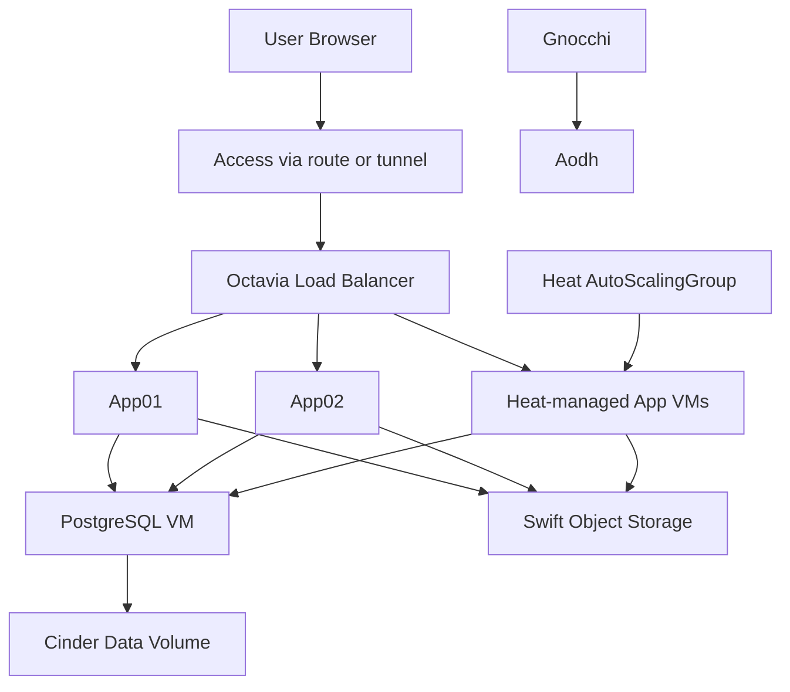

# MediaBox — OpenStack Private Cloud Media Platform

A private-cloud media management application deployed on OpenStack.

The project demonstrates a web application integrated with
OpenStack networking, object storage, block storage, identity,
load balancing, orchestration and monitoring services.

## 1. Project Overview

MediaBox provides application modules for:

- User authentication
- Media upload and metadata management
- Media listing and playback
- Media access permissions
- Swift object storage integration

The application backend uses Python/FastAPI.
The web interface is available at `/app`.

The project was developed and demonstrated in a multi-node
OpenStack private-cloud lab.

## 2. Technology Stack

| Layer | Technology |
|---|---|
| Web backend | Python, FastAPI |
| Frontend | HTML, CSS, JavaScript |
| Database | PostgreSQL |
| Object storage | OpenStack Swift |
| Block storage | OpenStack Cinder |
| Identity | OpenStack Keystone |
| Compute | OpenStack Nova |
| Networking | OpenStack Neutron |
| Load balancing | OpenStack Octavia |
| Orchestration | OpenStack Heat |
| Telemetry | Gnocchi |
| Alarming | Aodh |
| Deployment environment | OpenStack/Kolla-Ansible lab |

## 3. Architecture



The diagram represents architectural relationships.
Automatic Aodh-to-Heat scaling is not claimed as
fully verified.

See [System Architecture](docs/architecture/system-overview.md).

## 4. Verified Lab Configuration

| Component | Observed configuration |
|---|---|
| Private network | 10.20.0.0/24 |
| Public network | 192.168.57.0/24 |
| Database VM | mediabox-db, 10.20.0.11 |
| App01 | 10.20.0.89:8000 |
| App02 | 10.20.0.212:8000 |
| Heat backend 1 | 10.20.0.15:8000 |
| Heat backend 2 | 10.20.0.252:8000 |
| Load balancer VIP | 10.20.0.90:8000 |
| Load balancing | ROUND_ROBIN |
| Health check | GET /health |
| Swift container | mediabox-media |
| Database volume | mediabox-db-data, 5 GiB |

All four load-balancer members reported ONLINE
during the infrastructure inventory on 2026-11-22.

These addresses describe the original lab and are
not universal deployment defaults.

## 5. Repository Structure

```text
app/mediabox/           Canonical MediaBox application
infrastructure/heat/    Heat orchestration templates
infrastructure/neutron/ Neutron network scripts
infrastructure/octavia/ Octavia load balancer scripts
infrastructure/storage/ Swift and Cinder scripts
scripts/deployment/     Packaging and deployment helpers
scripts/security/       Repository security audit
tests/                  Application permission tests
docs/architecture/      Architecture and verified configurations
docs/deployment/        Deployment instructions
docs/validation/        Verification status
docs/evidence/          Evidence organization
report/                 Final project report
```

## 6. Build the Heat Application Bundle

The application has one canonical source directory:

`app/mediabox/`

To generate the application bundle:

```bash
python3 scripts/deployment/build_app_bundle.py
```

Output:

`infrastructure/heat/app-bundle.b64`

The generated bundle contains the application source
and requirements in a Base64-encoded TAR.GZ archive.

The bundle is generated locally and excluded from Git.

## 7. Infrastructure Deployment

The infrastructure scripts support a dry-run mode.

```bash
bash infrastructure/neutron/create_network.sh --dry-run
bash infrastructure/neutron/create_security_groups.sh --dry-run
bash infrastructure/storage/create_storage.sh --dry-run
bash infrastructure/octavia/create_loadbalancer.sh --dry-run
```

These scripts have passed Bash syntax checks and dry-run
checks, but have not been tested end-to-end on a fresh cloud.

Do not use `--apply` on the original lab environment.

See [Redeployment Guide](docs/deployment/redeployment.md).

## 8. Authentication and Secrets

This repository does not intentionally include:

- Keystone credentials or tokens
- Application Credential secrets
- PostgreSQL passwords
- JWT signing secrets
- SSH private keys
- Signed Heat action URLs
- Uploaded user media
- Database dumps

Use environment-specific configuration stored outside Git.

A pattern-based security audit is available at:

```bash
python3 scripts/security/audit_staging.py
```

A successful pattern scan does not replace manual review.

## 9. Verification Status

Verified in the original lab:

- Application frontend served at `/app`
- Frontend content matched the Controller source
- Four Octavia backend members ONLINE
- Swift container and uploaded objects present
- Cinder 5 GiB volume attached to the database VM
- Heat Stack in UPDATE_COMPLETE state
- Gnocchi resources and Aodh alarms present
- Manual scale-out demonstration

Not fully verified:

- Complete PostgreSQL schema and recovery procedure
- Fresh-cloud end-to-end redeployment
- Fully automatic Aodh-triggered scale-out and scale-in
- Equivalent behavior of all backend instances

See [Verification Matrix](docs/validation/verification-matrix.md).

## 10. Documentation

- [System Overview](docs/architecture/system-overview.md)
- [Network Topology](docs/architecture/network-topology.md)
- [PostgreSQL Data Model](docs/architecture/postgresql-data-model.md)
- [Identity and Monitoring](docs/architecture/identity-monitoring.md)
- [Aodh Parameters](docs/architecture/aodh-verified-parameters.md)
- [Redeployment Guide](docs/deployment/redeployment.md)
- [Storage and PostgreSQL](docs/deployment/storage-postgresql.md)
- [Evidence Guide](docs/evidence/README.md)

## 11. Project Scope

This repository documents an educational OpenStack
private-cloud deployment. It is not a production-ready
platform or a turnkey installer for arbitrary clouds.

Infrastructure scripts, configuration examples and
verification records should be adapted and tested
before use in another environment.
